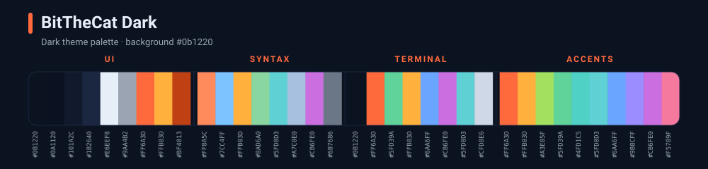
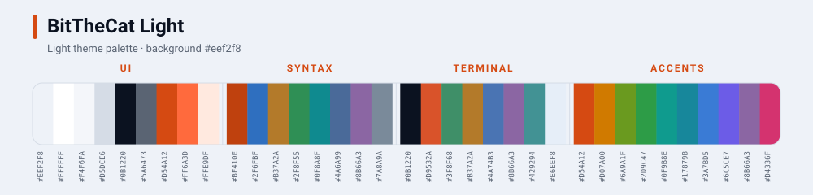

# BitTheCat — Theme for applications

## Files
- `src/` — the base palettes of the theme (`palette-dark.json`, `palette-light.json`):
  every color, listed for easy reading and reuse.
- `assets/palette-dark.svg`, `assets/palette-light.svg` — palette previews used below.
- `{application-name}/` — the theme family for the application (e.g. `zed/`, `sublime/`).

## Palette

