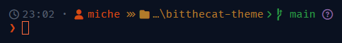
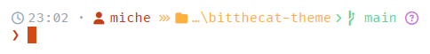

# BitTheCat for Starship

A [Starship](https://starship.rs) prompt using the BitTheCat palette.

## Preview





## Install

Copy `starship.toml` to your Starship config:

- **Default:** `~/.config/starship.toml`
- **Custom path:** set `STARSHIP_CONFIG` to the file location

> Requires a **Nerd Font** in your terminal (for the icons).

## Palettes

Two palettes are defined, so you can switch the whole prompt with one line:

```toml
palette = 'bitthecat_dark'   # or 'bitthecat_light'
```